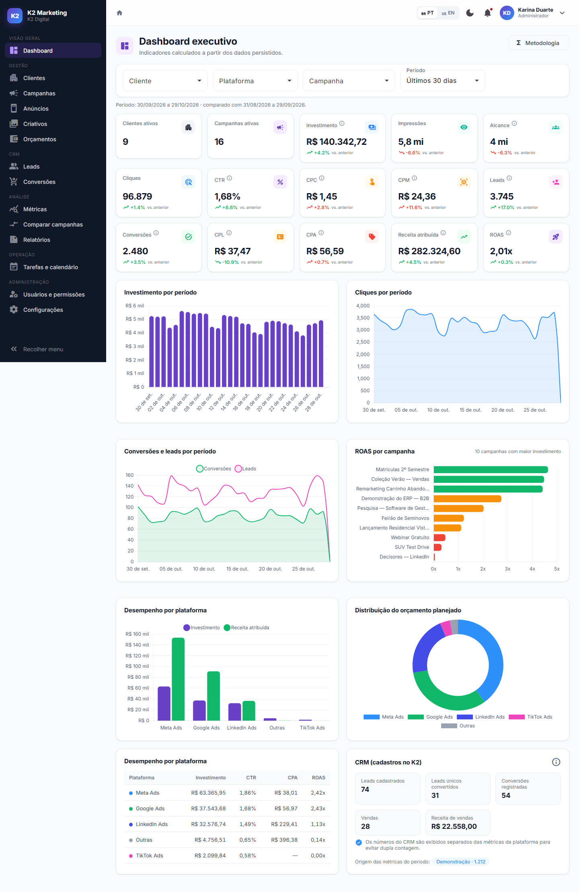
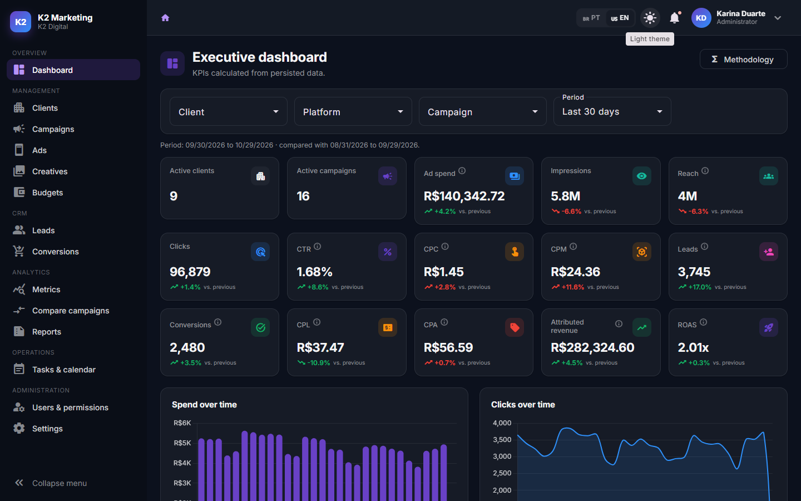
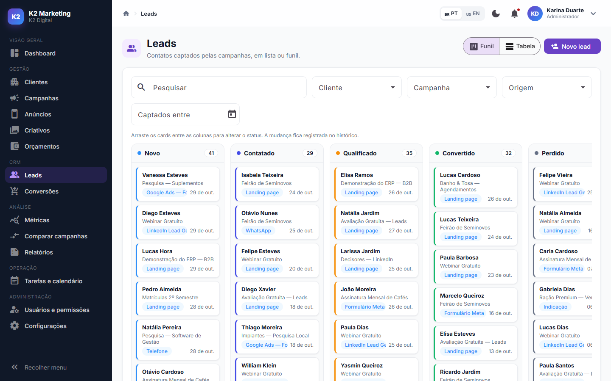
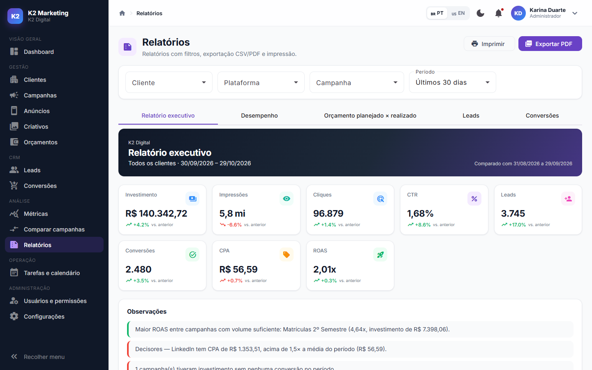
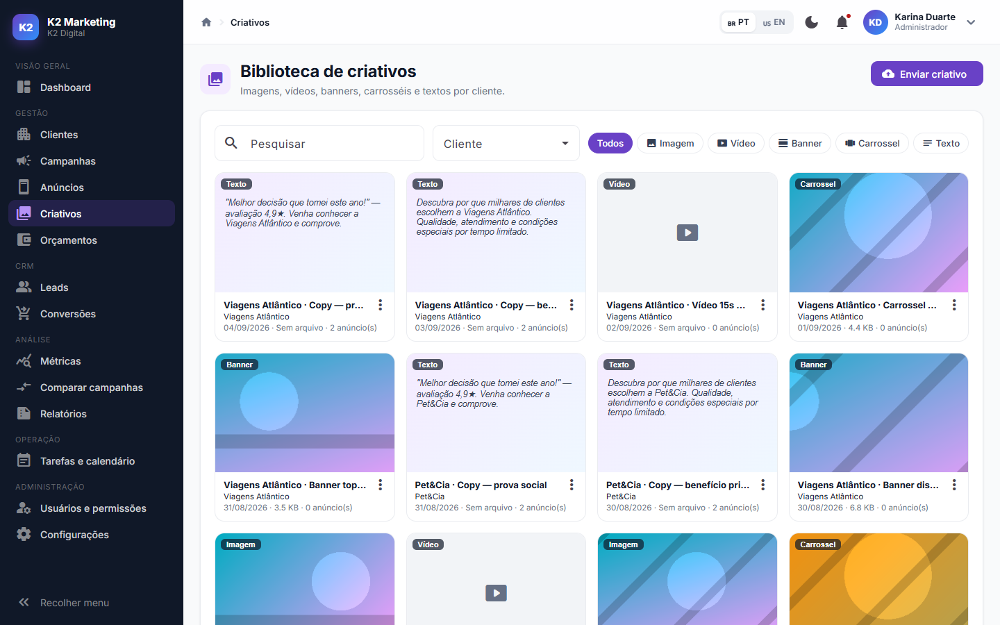
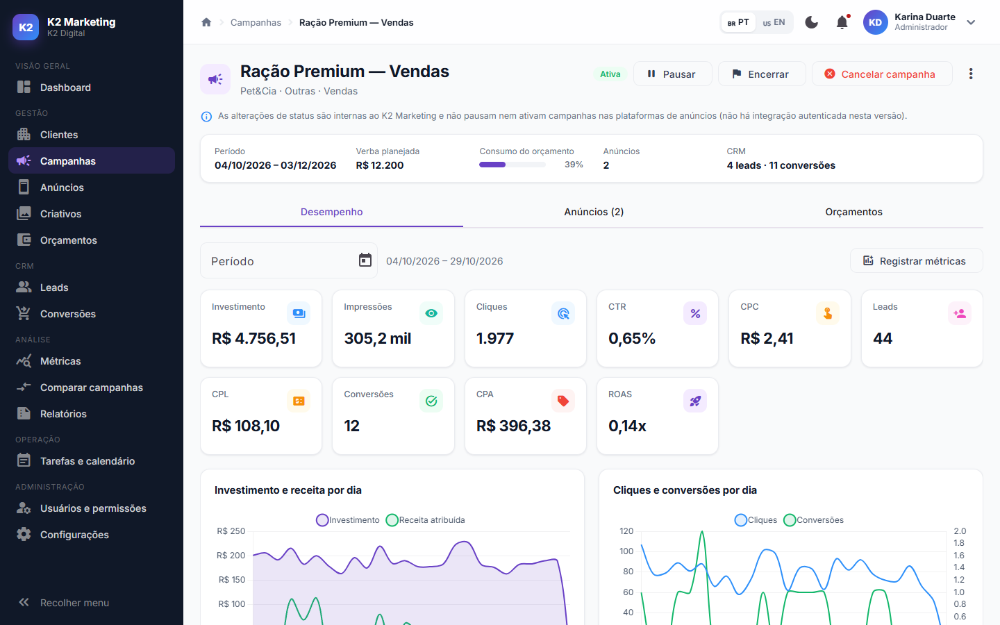
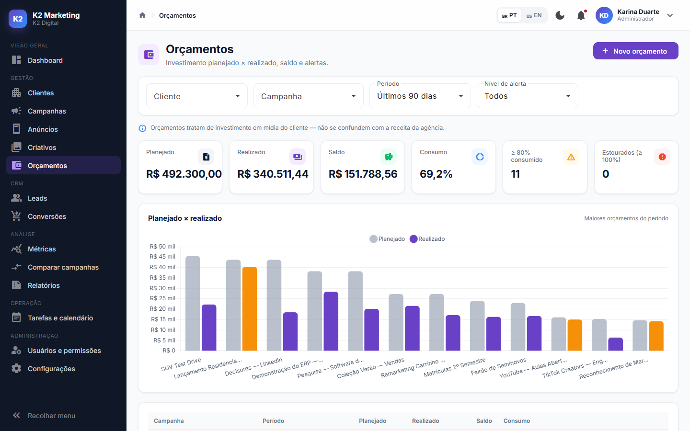
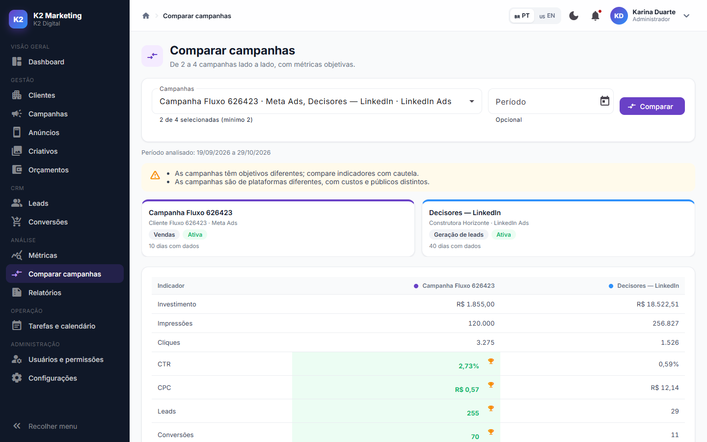
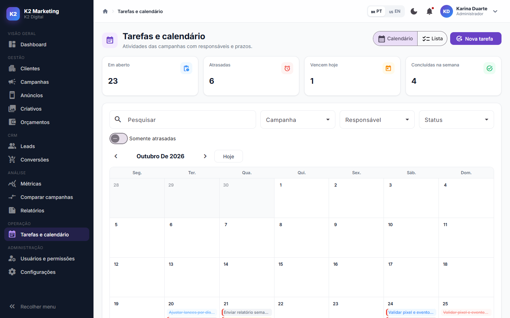

# K2 Marketing

**Plataforma SaaS de gestão de marketing digital e tráfego pago** para agências, gestores de tráfego e empresas que administram clientes, campanhas, anúncios, investimentos e resultados.

Indicadores como CTR, CPC, CPM, CPL, CPA e ROAS são **calculados no servidor a partir dos dados persistidos**, nunca fixos no frontend. A interface é bilíngue (🇧🇷 português / 🇺🇸 inglês) e tem tema claro e escuro.



---

## Sumário

- [Tecnologias](#tecnologias)
- [Funcionalidades](#funcionalidades)
- [Arquitetura](#arquitetura)
- [Execução com Docker](#execução-com-docker)
- [Execução local (desenvolvimento)](#execução-local-desenvolvimento)
- [Banco de dados](#banco-de-dados)
- [Usuários de demonstração](#usuários-de-demonstração)
- [Testes](#testes)
- [Fluxo de demonstração](#fluxo-de-demonstração)
- [Metodologia dos indicadores](#metodologia-dos-indicadores)
- [Segurança e LGPD](#segurança-e-lgpd)
- [Capturas de tela](#capturas-de-tela)
- [Limitações desta versão](#limitações-desta-versão)
- [Integrações futuras](#integrações-futuras)

---

## Tecnologias

| Camada | Stack |
|---|---|
| **Backend** | C# / .NET 8, ASP.NET Core Web API, Entity Framework Core 8, PostgreSQL 16, FluentValidation, JWT + refresh token, Swagger, Serilog |
| **Frontend** | Angular 20 (standalone components, Signals, RxJS, Reactive Forms), Angular Material, Chart.js, Transloco (i18n), CDK Drag & Drop, jsPDF |
| **Testes** | xUnit, FluentAssertions, `WebApplicationFactory`, Testcontainers (PostgreSQL real) |
| **Infra** | Docker, Docker Compose, Nginx, GitHub Actions, variáveis de ambiente |

Não há microsserviços, mensageria nem cache distribuído nesta versão: é um monólito modular em Clean Architecture.

## Funcionalidades

| Módulo | O que faz |
|---|---|
| **Dashboard executivo** | 15 indicadores (clientes ativos, campanhas ativas, investimento, impressões, alcance, cliques, CTR, CPC, CPM, leads, conversões, CPL, CPA, receita atribuída e ROAS), cada um com variação em relação ao período anterior. Gráficos de investimento, cliques e conversões por período, ROAS por campanha, desempenho por plataforma e distribuição do orçamento. Filtros por cliente, plataforma, campanha e período. |
| **Clientes** | Cadastro, edição, ativação/desativação, busca e filtros. Página de detalhes com as abas Visão geral, Campanhas, Anúncios, Leads, Resultados, Relatórios e Histórico (auditoria). |
| **Campanhas** | Criar, editar, duplicar (cópia como rascunho, com anúncios e criativos), pausar, reativar, encerrar e cancelar. As transições de status são validadas no domínio. Desempenho diário e por anúncio, além de filtros por cliente, plataforma, status, objetivo e período. |
| **Anúncios** | CRUD, duplicação, vínculo de criativos do mesmo cliente, prévia em formato de feed, visualização em cards ou tabela e comparação de 2 a 4 anúncios. |
| **Criativos** | Upload de imagem, vídeo, banner e carrossel, além de criativos de texto. Validação de extensão, tamanho e **assinatura binária** do arquivo. Os arquivos são servidos apenas por endpoint autenticado, com isolamento por cliente. |
| **Orçamentos** | Planejado × realizado, saldo, registro de gasto, histórico diário com ritmo planejado e alertas de 80%, 90% e 100% (cada um enviado uma única vez). Períodos sobrepostos são bloqueados. |
| **Leads** | Lista e funil **Kanban com drag-and-drop**, histórico de contatos, mudança de status registrada, consentimento LGPD e exclusão definitiva dos dados pessoais. |
| **Conversões** | Registro manual ou importação CSV, com **deduplicação por evento**. Distingue conversões gerais, leads únicos convertidos e vendas. |
| **Métricas** | Registro diário por campanha/anúncio com prévia dos indicadores calculados. **Importação CSV** com prévia, validação de colunas, tratamento de duplicidades (ignorar ou substituir) e confirmação antes de gravar. |
| **Comparação** | 2 a 4 campanhas lado a lado. Os destaques consideram apenas campanhas com volume suficiente, com avisos de objetivo, plataforma e qualidade dos dados. |
| **Relatórios** | Executivo (com observações objetivas), desempenho por cliente/campanha/plataforma, orçamento, leads e conversões. Exportação **CSV**, **PDF** com a identidade visual da agência e impressão. |
| **Tarefas e calendário** | Tarefas por cliente/campanha, responsáveis, prazos, prioridades, visão de calendário mensal e alertas de atraso. |
| **Usuários e permissões** | Perfis ADMIN, MANAGER, ANALYST e CLIENT_VIEWER, com autorização no backend e no frontend. |
| **Notificações** | Central no header para campanha próxima do encerramento, orçamento atingindo limite, tarefa atrasada, novo lead e relatório mensal disponível. |
| **Central de Aprendizado** | Recursos educativos opcionais (detalhes abaixo): 10 temas explicados, ajuda em todos os indicadores, Modo Iniciante, tour interativo, campanhas de exemplo, simulador e glossário. |
| **Configurações** | Perfil (idioma, tema, senha), identidade da agência (nome, cor, rodapé dos relatórios), status das integrações e trilha de auditoria. |

### Recursos educativos (Central de Aprendizado)

O K2 Marketing continua sendo uma plataforma profissional. Os recursos abaixo são **opcionais** e ajudam iniciantes a entender campanhas, anúncios, investimentos e resultados:

| Recurso | Como funciona |
|---|---|
| **Central de Aprendizado** (`/learn`) | 10 temas em linguagem simples, com exemplos de pequenas empresas brasileiras: marketing digital, campanha, anúncio, criativos, tráfego pago, orçamento, leads, conversões, interpretação de resultados e relatórios. |
| **Ajuda nos indicadores** | Ícone ⓘ em todos os cards de KPI (Impressões, Alcance, Cliques, CTR, CPC, CPM, CPL, CPA, ROAS, Leads, Conversões, Receita atribuída e Investimento) com significado, fórmula, exemplo e interpretação. As explicações nunca afirmam que um valor é "sempre bom ou ruim". |
| **🎓 Modo Iniciante** (header) | Ligado: mostra dicas no dashboard, nos gráficos, nos formulários, nos relatórios e uma linha explicativa em cada KPI. Desligado: interface profissional, com os ícones de ajuda ainda disponíveis. A preferência fica salva no `localStorage`. |
| **▶ Tour pelo sistema** (header) | 10 etapas que abrem as telas reais e destacam o elemento correspondente (Dashboard → cliente → campanha → orçamento → anúncio → criativo → resultados → métricas → lead → relatório). Tem Próximo, Anterior, Pular e Finalizar, não bloqueia a interface e pode ser reiniciado a qualquer momento. |
| **Campanhas de exemplo** (`/learn/examples`) | Padaria Jardim Andrade, Studio Bella e Imobiliária Horizonte, com dados **simulados**, funil do anúncio à venda, cálculos explicados e a diferença entre clique, lead e venda. |
| **Simulador de Resultados** (`/learn/simulator`) | Calcula CTR, CPC, CPM, CPL, CPA e ROAS no navegador, mostrando a conta feita com os números informados. É isolado: não chama a API nem altera nenhum dado. |
| **Glossário** (`/learn/glossary`) | 21 termos com explicação, exemplo prático e termo em inglês, com busca nos dois idiomas e filtro por letra. |
| **Ajuda nos formulários** | Ícone ⓘ nos campos principais (objetivo, orçamento, CTA, origem do lead, tipo de conversão...) e um painel explicativo no Modo Iniciante. As validações existentes não foram alteradas. |

Todo o conteúdo está em português e inglês (Transloco). Os exemplos e o simulador não gravam nada no banco de dados.

## Arquitetura

```
K2 MARKETING/
├── BackEnd/                         # .NET 8 — Clean Architecture
│   ├── src/
│   │   ├── K2Marketing.Domain/          # Entidades, enums, regras (transições de status), MetricCalculator
│   │   ├── K2Marketing.Application/     # Serviços de caso de uso, DTOs, FluentValidation, AccessScope,
│   │   │                                #   importação CSV, relatórios, interfaces de integrações futuras
│   │   ├── K2Marketing.Infrastructure/  # EF Core + PostgreSQL, migrations, JWT/PBKDF2, storage de arquivos,
│   │   │                                #   seed de demonstração, job de notificações
│   │   └── K2Marketing.Api/             # Controllers /api/v1, middleware de erros, Swagger, Serilog, rate limiting
│   ├── tests/
│   │   ├── K2Marketing.UnitTests/       # Fórmulas, regras de domínio, CSV, deduplicação, upload
│   │   └── K2Marketing.IntegrationTests/# API + PostgreSQL real (Testcontainers)
│   └── Dockerfile
├── FrontEnd/k2-marketing-web/       # Angular 20 standalone + Signals
│   ├── src/app/core/                    # Auth, guards, interceptors, i18n, tema, serviços globais
│   ├── src/app/shared/                  # Modelos, pipes, helpers e componentes reutilizáveis (KPI, gráfico, filtros...)
│   ├── src/app/layout/shell/            # Shell: sidebar recolhível, header, breadcrumbs, notificações
│   ├── src/app/features/<módulo>/       # Uma pasta por módulo (lazy loading), com uma subpasta por componente:
│   │   └── clients-page/                #   clients-page.ts + clients-page.html + clients-page.css
│   ├── src/styles.scss                  # Tokens de tema (claro/escuro), tema do Material e classes compartilhadas
│   ├── public/i18n/                     # pt-BR.json e en-US.json
│   ├── nginx.conf                       # SPA + proxy /api → container da API
│   └── Dockerfile
├── docs/                            # Metodologia, CSVs de exemplo e capturas de tela
├── .github/workflows/ci.yml         # Build + testes + imagens Docker
├── docker-compose.yml
└── .env.example
```

**Decisões principais**

- **Fonte única de verdade do investimento:** o gasto vem de `CampaignMetrics.Spend`. O `ActualSpend` dos orçamentos é sincronizado a partir das métricas, e o "registrar gasto" soma ao valor do dia em vez de criar um segundo lançamento.
- **Plataforma × CRM:** leads e conversões reportados nas métricas e os cadastrados no CRM aparecem em blocos separados e **nunca são somados**.
- **Indicadores derivados nunca são gravados:** são calculados a cada consulta a partir dos totais somados (nunca média de médias). Divisão por zero retorna `null` (exibido como "—").
- **Isolamento por cliente** (`AccessScope`): CLIENT_VIEWER só enxerga o próprio cliente. Recursos de outro cliente respondem **404**, sem revelar que existem.
- **Erros com código estável** (`ProblemDetails.code`), traduzidos no frontend.

**API REST versionada** (documentada no Swagger em `/swagger`):
`/api/v1/auth`, `users`, `clients`, `campaigns`, `advertisements`, `creatives`, `budgets`, `leads`, `conversions`, `metrics`, `imports`, `reports`, `tasks`, `dashboard`, `notifications` e `settings`. As listagens aceitam paginação (`page`, `pageSize`), ordenação (`sortBy`, `sortDir`), busca (`search`) e filtros específicos.

## Execução com Docker

Pré-requisitos: Docker e Docker Compose.

```bash
cp .env.example .env        # defina JWT_SECRET (32+ caracteres) e, em produção, uma senha forte para o banco
docker compose up -d --build
```

| Serviço | URL |
|---|---|
| Aplicação web | http://localhost:4290 |
| API + Swagger | http://localhost:5090/swagger |
| PostgreSQL | `localhost:5435` |

Na primeira inicialização a API aplica as migrations e gera os dados de demonstração (`SEED_DEMO_DATA=true`). Os volumes `k2-marketing-pgdata` (banco) e `k2-marketing-storage` (criativos enviados) são persistentes. Para recomeçar do zero, use `docker compose down -v`.

## Execução local (desenvolvimento)

Pré-requisitos: .NET SDK 8.0.419+ (fixado em `global.json`), Node 22+ e Docker (para o PostgreSQL).

```bash
# 1. Banco de dados
cp .env.example .env
docker compose up -d k2-marketing-postgres

# 2. API (http://localhost:5091) — aplica migrations e seed automaticamente
#    (porta diferente da API do Docker, 5090, para os dois poderem rodar juntos)
cd BackEnd
dotnet run --project src/K2Marketing.Api --launch-profile http

# 3. Frontend (http://localhost:4200, com proxy /api → 5091)
cd FrontEnd/k2-marketing-web
npm install
npm start
```

A connection string e o segredo JWT de desenvolvimento ficam em `appsettings.Development.json`, apenas para uso local. Em qualquer outro ambiente, configure `ConnectionStrings__Default` e `Jwt__Secret` por variável de ambiente.

## Banco de dados

PostgreSQL 16 com EF Core e a migration `InitialCreate`, que cria: **Users, Roles, RefreshTokens, Clients, Campaigns, Advertisements, AdvertisementCreatives, CreativeAssets, CampaignBudgets, Leads, LeadInteractions, Conversions, CampaignMetrics, MarketingTasks, Notifications, AuditLogs e AgencySettings**.

- Chaves estrangeiras com comportamento explícito (`Restrict` para preservar histórico, `Cascade`/`SetNull` onde faz sentido).
- **Restrições de integridade** (check constraints): datas finais ≥ iniciais, valores monetários ≥ 0, métricas não negativas e CLIENT_VIEWER obrigatoriamente vinculado a um cliente.
- **Índices únicos de negócio:** `CampaignMetrics (CampaignId, AdvertisementId, Date)` com `NULLS NOT DISTINCT`, `Conversions (CampaignId, EventKey)`, e-mail de usuário, documento do cliente e deduplicação de notificações.
- Valores monetários em `numeric(18,2)`. Enums de negócio gravados como texto.
- Operações críticas (importação CSV, registro de gasto, seed) rodam em **transação**.

Para criar uma nova migration:

```bash
cd BackEnd
dotnet tool restore
dotnet ef migrations add NomeDaMigration -p src/K2Marketing.Infrastructure -s src/K2Marketing.Infrastructure -o Persistence/Migrations
```

## Usuários de demonstração

Contas fictícias criadas pelo seed, **apenas para demonstração**. Altere as senhas ou desative o seed em produção.

| Perfil | E-mail | Senha | Acesso |
|---|---|---|---|
| ADMIN | admin@k2digital.com.br | `Admin@123` | Completo, incluindo usuários, configurações e auditoria |
| MANAGER | gerente@k2digital.com.br | `Gerente@123` | Clientes, campanhas, orçamentos e relatórios |
| ANALYST | analista@k2digital.com.br | `Analista@123` | Campanhas, anúncios, criativos, métricas, leads e conversões |
| CLIENT_VIEWER | cliente@bellamoda.com.br | `Cliente@123` | Somente dados e relatórios da Bella Moda |

**Dados gerados:** agência K2 Digital, 10 clientes (1 inativo), 25 campanhas em todos os status, 60 anúncios, 100 criativos (70 com imagem gerada), 150 leads com histórico, 120 conversões, ~90 dias de métricas diárias, orçamentos coerentes com o gasto, 30 tarefas e notificações. Há campanhas **boas, medianas e de baixo desempenho**, e todos os gráficos derivam desses registros.

## Testes

```bash
cd BackEnd
dotnet test tests/K2Marketing.UnitTests          # 50 testes
dotnet test tests/K2Marketing.IntegrationTests   # 24 testes — requer Docker (Testcontainers)
```

| Área | Cobertura |
|---|---|
| Cálculos | CTR, CPC, CPM, CPL, CPA, ROAS, divisão por zero, precisão decimal, agregação por totais, limites de orçamento |
| Domínio | Transições de status de campanha (válidas e inválidas) |
| Autenticação | Login, credenciais inválidas, token obrigatório, rotação de refresh token e revogação por reuso, preferência de idioma |
| Permissões | Analista × gerente × admin, CLIENT_VIEWER somente leitura |
| Isolamento | CLIENT_VIEWER só vê o próprio cliente (listas, dashboard, relatórios, arquivos) e recebe 404 para os demais |
| CRUD | Clientes (validação 400, documento duplicado 409, desativação) e campanhas (datas, duplicação, exclusão bloqueada) |
| Orçamentos | Sincronização do realizado a partir das métricas, registro de gasto sem lançamento duplicado, período e alertas únicos de 80/90% |
| Importação CSV | Prévia sem gravação, colunas ausentes, duplicadas no banco e no arquivo, inválidas, modos Ignorar/Substituir, CSV de conversões |
| Conversões | Deduplicação por ID externo e lead+tipo; conversões gerais × leads únicos × vendas |
| Upload | Rejeição de arquivo com assinatura falsa e acesso ao arquivo restrito a quem pode ver o cliente |

**Frontend:**

```bash
cd FrontEnd/k2-marketing-web
npx ng test --watch=false --browsers=ChromeHeadless   # 10 testes
```

Os testes cobrem os cálculos do simulador (fórmulas, arredondamento e divisão por zero, iguais aos do backend), a coerência dos exemplos educativos, a persistência do Modo Iniciante e a navegação do tour (avançar, voltar, pular, finalizar e reiniciar).

O frontend também foi validado com automação de navegador:

- todas as telas carregam sem erros de console;
- o fluxo de demonstração completo foi executado pela interface;
- os recursos educativos passaram em 44 verificações: Modo Iniciante ligado/desligado e persistência, diálogos de ajuda, valores do simulador, exemplos, busca no glossário, tradução PT/EN, as 10 etapas do tour e a ausência de gravações na API.

## Fluxo de demonstração

```
LOGIN → DASHBOARD → CADASTRAR CLIENTE → CRIAR CAMPANHA → DEFINIR ORÇAMENTO → CADASTRAR ANÚNCIO
→ VINCULAR CRIATIVO → REGISTRAR OU IMPORTAR MÉTRICAS → VISUALIZAR RESULTADOS → CADASTRAR LEADS
→ REGISTRAR CONVERSÕES → COMPARAR CAMPANHAS → GERAR RELATÓRIO PDF
```

1. Entre como **admin** (botões de preenchimento na tela de login).
2. **Clientes → Novo cliente.**
3. **Campanhas → Nova campanha** (abre o detalhe da campanha ao salvar).
4. Na aba **Orçamentos** da campanha → *Novo orçamento*.
5. Na aba **Anúncios** → *Novo anúncio* (com prévia ao vivo).
6. **Criativos → Enviar criativo** e, em **Anúncios**, ⋮ → *Vincular criativos*.
7. **Métricas → Importar CSV**: baixe o modelo (já preenchido com campanhas reais) ou use `docs/samples/metricas-exemplo.csv`, revise a prévia e confirme.
8. Veja os resultados no detalhe da campanha e no **Dashboard**: o consumo do orçamento é atualizado automaticamente.
9. **Leads → Novo lead** e arraste o card no funil.
10. No lead, clique em *Registrar conversão* (tentar registrar o mesmo pedido de novo é recusado).
11. **Comparar campanhas**: selecione de 2 a 4.
12. **Relatórios → Exportar PDF.**

Todos os passos gravam no PostgreSQL. Esse fluxo foi executado de ponta a ponta pela interface durante a validação.

## Metodologia dos indicadores

| Indicador | Fórmula |
|---|---|
| CTR (%) | (Cliques ÷ Impressões) × 100 |
| CPC | Investimento ÷ Cliques |
| CPM | (Investimento ÷ Impressões) × 1.000 |
| CPL | Investimento ÷ Leads |
| CPA | Investimento ÷ Conversões |
| ROAS | Receita atribuída ÷ Investimento |

Detalhes sobre origem dos dados (manual, CSV, demonstração), regras contra dupla contagem e critérios da comparação estão em [docs/METODOLOGIA.md](docs/METODOLOGIA.md) e na página **Metodologia** dentro do sistema.

## Segurança e LGPD

- JWT de curta duração (15 min) com **refresh token rotativo de uso único**. Apenas o hash SHA-256 é persistido, e reutilizar um token revoga todas as sessões do usuário.
- Senhas com **PBKDF2** (ASP.NET Core Identity) e política mínima (8+ caracteres, maiúscula, minúscula e número). Trocar ou redefinir a senha encerra as sessões ativas.
- **RBAC** no backend (`[Authorize(Roles)]`) e no frontend (guards e ações condicionais), além de isolamento de dados por cliente.
- **Rate limiting** em login, refresh e troca de senha. CORS restrito por configuração. Cabeçalhos de segurança aplicados.
- **Upload validado:** extensão, tamanho, assinatura binária e nome aleatório no disco (sem path traversal). Os arquivos só são servidos por endpoint autenticado.
- Tratamento global de erros com `ProblemDetails`, sem expor stack traces.
- **Serilog** com logs estruturados e **trilha de auditoria** das alterações.
- **LGPD:** consentimento registrado no lead, exclusão definitiva dos dados pessoais pelo gestor, CSV exportado com proteção contra injeção de fórmulas e dados mínimos nas notificações.
- Nenhuma credencial real no repositório: `.env` é ignorado pelo git e há um `.env.example` com placeholders.

## Capturas de tela

| | |
|---|---|
|  |  |
|  |  |
|  |  |
|  |  |

## Limitações desta versão

- **Sem integração real com plataformas de anúncios.** As mudanças de status de campanha são internas ao K2 Marketing e não pausam nem ativam nada no Meta Ads ou no Google Ads. Os dados entram por cadastro manual, CSV ou seed de demonstração.
- **Uma agência por instalação** (não é multi-tenant). O isolamento é entre clientes da agência.
- Os criativos ficam em disco local (volume Docker); armazenamento em nuvem (S3/Blob) é uma evolução natural via `IFileStorage`.
- O **alcance agregado** é a soma do alcance diário informado e pode contar as mesmas pessoas em dias diferentes, limitação de qualquer fonte sem deduplicação de usuários.
- As notificações são atualizadas por polling (60 s), sem push em tempo real.
- Os vídeos de demonstração não incluem arquivo; uploads reais de vídeo (MP4/WebM/MOV até 100 MB) funcionam normalmente.
- O PDF é gerado no navegador (jsPDF), não há agendamento de envio por e-mail, e o seed usa senhas de demonstração conhecidas.

## Integrações futuras

A camada Application já define os contratos, com adaptadores "não configurados" que **nunca simulam dados**:

| Interface | Uso previsto |
|---|---|
| `IAdPlatformConnector` | Meta Marketing API, Google Ads API, TikTok e LinkedIn: importar métricas diárias com `Source = Integration` |
| `IAnalyticsConnector` | Google Analytics: sessões e conversões do site |
| `IWebhookPublisher` | Eventos de lead, conversão e orçamento para sistemas externos |
| `IAiInsightsService` | Resumos de desempenho e sugestões de copy com IA |

O status de cada integração aparece em **Configurações → Integrações**. Para implementar um conector real, basta registrar uma nova implementação no `DependencyInjection` da Application ou da Infrastructure.
